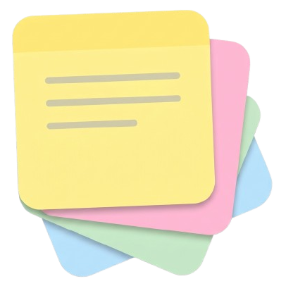

<div align="center">



# Stikly

**Sticky notes that actually stay stuck to your desk.**

Free and open source sticky notes app for Windows 10 & 11.

[](https://github.com/wilkcraft/stikly)
[](LICENSE)
[](https://stikly.wilkcraft.work/)
[](https://www.electronjs.org/)

[Website](https://stikly.wilkcraft.work/) · [Download](https://stikly.wilkcraft.work/#download) · [Report a bug](https://github.com/wilkcraft/stikly/issues)

</div>

---

## ✨ What is Stikly?

Stikly turns your desktop into a real bulletin board. Each note is its own small
window, without borders or a Windows title bar, so you can have as many as you
like, in any color you choose, pinned wherever you want.

Everything is saved **locally on your computer**. Stikly does not send anything
to any server and needs no account.

## 📥 Download

Get the latest version from the [official website](https://stikly.wilkcraft.work/#download)
or from the [Releases](https://github.com/wilkcraft/stikly/releases) page.

| Version   | Description                            |
| --------- | -------------------------------------- |
| Installer | `Stikly Setup 1.4.0.exe`               |
| Portable  | `Stikly 1.4.0.exe` – no install needed |

## 🚀 Features

- **Formatted text** – bold, italic, underline, strikethrough, text color and highlighter.
- **Lists & checklists** – bulleted, numbered and checklists (click a box to cross out the line).
- **Move and resize** – Stikly remembers the position and size of every note.
- **Custom colors** – four preset colors plus a full color picker. The bars adjust their contrast automatically.
- **My notes panel** – browse, search, import, open or delete all your saved notes (`Ctrl+O`).
- **Auto-save on exit** – every note with text is saved automatically, named after its first line.
- **Light / dark theme** – follows Windows or can be set manually.
- **System tray** – create a note or close them all from the tray icon.
- **Always starts on your notes** – Stikly opens the "My notes" panel on every launch; create a new note from there with one click.
- **Multi-monitor safe** – if a monitor is unplugged, notes that were on it are moved to your main screen automatically.
- **Update notifications (optional)** – Stikly can check GitHub Releases for new versions. It asks on first run and nothing is installed automatically.

### 📌 Three ways to pin a note

| Mode              | Behavior                                                                   |
| ----------------- | -------------------------------------------------------------------------- |
| **On desktop**    | Sits behind your icons. Doesn't hide anything and doesn't show in Alt+Tab. |
| **Normal**        | A regular window: can be covered and appears in Alt+Tab.                   |
| **Always on top** | Floats above any other window.                                             |

## 🔒 Your data

Every note is saved as its own `.json` file in:

```
%APPDATA%\stikly\notes
```

To back up your notes, just copy that folder.

- **Update notifications (optional)** – Stikly can check GitHub Releases for new versions. It asks on first run and nothing is installed automatically.

## 🧠 How it works

Stikly is an [Electron](https://www.electronjs.org/) app that also talks directly
to the Windows API to move notes between desktop layers.

| File                                 | Purpose                                                                                                       |
| ------------------------------------ | ------------------------------------------------------------------------------------------------------------- |
| `main.js`                            | Electron main process: creates note windows, saves notes, tray icon, notes panel and display-change handling. |
| `preload.js`                         | Safe bridge (`contextBridge`) between the UI and the main process.                                            |
| `note.html` / `note.js` / `note.css` | The note interface: text area, format bar, color and position menus.                                          |
| `library.html` / `.js` / `.css`      | The "My notes" panel. Previews are rebuilt through a strict HTML sanitizer.                                   |
| `windows-window.ps1` + `.cs`         | Compiles C# at runtime and calls `SetParent` / `SetWindowPos` to change window layers.                        |

## 🛠️ Run from source

**Requirements:** [Node.js](https://nodejs.org/) (LTS) and Windows 10/11.

```bash
# Clone the repository
git clone https://github.com/wilkcraft/stikly.git
cd stikly

# Install dependencies
npm install

# Run in development
npm start

# Build the installer and portable version
npm run build
```

## 🤝 Contributing

Stikly is **open source** and contributions are welcome!

1. Fork the project
2. Create your branch: `git checkout -b feature/my-feature`
3. Commit your changes: `git commit -m "Add my feature"`
4. Push to the branch: `git push origin feature/my-feature`
5. Open a Pull Request

Found a bug or have an idea? [Open an issue](https://github.com/wilkcraft/stikly/issues).

## 📄 License

Distributed under the **MIT License**. See [`LICENSE`](LICENSE) for more information.

## 👤 Author

Developed by [**Wilkcraft**](https://www.wilkcraft.work/).

- Website: [stikly.wilkcraft.work](https://stikly.wilkcraft.work/)
- Privacy Policy: [privacy](https://stikly.wilkcraft.work/privacy.html)
